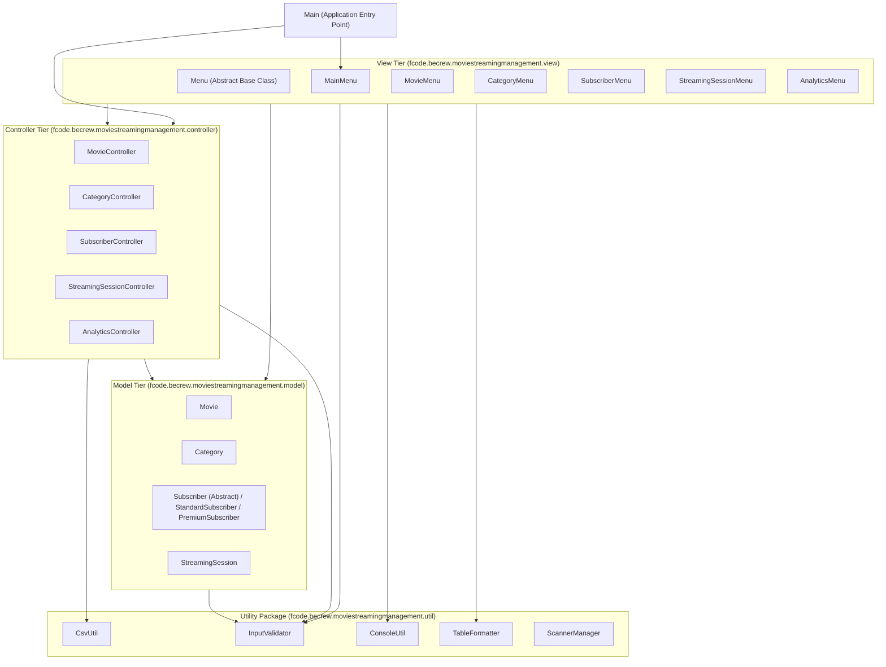

# Architecture and Data Model Specification

This document defines the 3-tier Model-View-Controller (`MVC`) architecture, package boundaries, UML class diagrams, Java Collections Framework usage, and CSV file schemas for the Movie Streaming Management System.

---

## 1. Standard 3-Tier MVC Architecture

The application is structured into three core architectural tiers (`view`, `controller`, `model`) supported by a stateless utility package (`util`) under the root package `fcode.becrew.moviestreamingmanagement`.

### Tier Responsibilities and Dependency Boundaries

| Package | Architectural Role | Allowed Outgoing Dependencies |
| :--- | :--- | :--- |
| `view` | Renders 80-column ASCII menus and tables, prompts the operator for input via `ConsoleUtil`, catches exceptions, and displays status messages. Contains zero business calculations or file I/O logic. | `controller`, `model`, `util` |
| `controller` | Coordinates stateful business logic, manages in-memory `List`, `Map`, and `Set` collections, executes ranking algorithms, and directs atomic CSV persistence via `CsvUtil`. Contains zero `System.out` or `Scanner` calls. | `model`, `util` |
| `model` | Encapsulates domain state, object relationships (`Movie` to `Category`, `StreamingSession` to `Movie` and `Subscriber`), polymorphic behaviors (`Subscriber.calculateMonthlyFee`), and constructor invariant checks via `InputValidator`. | `util` (`InputValidator`) |
| `util` | Provides reusable, stateless infrastructure for RFC 4180 CSV parsing and atomic file replacement (`CsvUtil`), invariant validation (`InputValidator`), 80-column formatting (`TableFormatter`), console I/O (`ConsoleUtil`), and stream management (`ScannerManager`). | Standard JDK 8 APIs only |

---

## 2. UML Class Diagram

```mermaid
classDiagram
    direction TB

    class Movie {
        -String id
        -String title
        -String categoryId
        -String director
        -String cast
        -int releaseYear
        -int durationMinutes
        -double rating
        -int viewCount
        -boolean isDeleted
        +Movie(String id, String title, String categoryId, String director, String cast, int releaseYear, int durationMinutes, double rating, int viewCount, boolean isDeleted)
        +incrementViewCount() void
        +decrementViewCount() void
        +isDeleted() boolean
        +setDeleted(boolean isDeleted) void
    }

    class Category {
        -String id
        -String name
        -String description
        -boolean isDeleted
        +Category(String id, String name, String description, boolean isDeleted)
        +isDeleted() boolean
        +setDeleted(boolean isDeleted) void
    }

    class Subscriber {
        <<abstract>>
        -String id
        -String fullName
        -String phone
        -String email
        -boolean isDeleted
        #Subscriber(String id, String fullName, String phone, String email, boolean isDeleted)
        +create(String tier, String id, String fullName, String phone, String email, boolean isDeleted)$ Subscriber
        +calculateMonthlyFee()* double
        +getMaxConcurrentStreams()* int
        +getTierName()* String
    }

    class StandardSubscriber {
        +STANDARD_FEE : double = 7.99$
        +STANDARD_STREAMS : int = 2$
        +StandardSubscriber(String id, String fullName, String phone, String email, boolean isDeleted)
        +calculateMonthlyFee() double
        +getMaxConcurrentStreams() int
        +getTierName() String
    }

    class PremiumSubscriber {
        +PREMIUM_FEE : double = 14.99$
        +PREMIUM_STREAMS : int = 4$
        +PremiumSubscriber(String id, String fullName, String phone, String email, boolean isDeleted)
        +calculateMonthlyFee() double
        +getMaxConcurrentStreams() int
        +getTierName() String
    }

    class StreamingSession {
        -String sessionId
        -String subscriberId
        -String movieId
        -LocalDateTime sessionDate
        -int watchedMinutes
        -boolean isCompleted
        +StreamingSession(String sessionId, String subscriberId, String movieId, LocalDateTime sessionDate, int watchedMinutes, boolean isCompleted)
        +isCompleted() boolean
    }

    class MovieController {
        -Path csvPath
        -List~Movie~ movies
        -CategoryController categoryController
        +loadFromCsv() void
        +saveToCsv() void
        +addMovie(String title, String categoryId, String director, String cast, int year, int duration, double rating) Movie
        +updateMovie(String id, String title, String categoryId, String director, String cast, int year, int duration, double rating) void
        +deleteMovie(String id) void
        +findById(String id) Movie
        +findByIdIncludeDeleted(String id) Movie
        +getAllActiveMovies() List~Movie~
        +search(String keyword) List~Movie~
        +filter(Predicate~Movie~ criteria) List~Movie~
        +hasActiveMoviesForCategory(String categoryId) boolean
    }

    class CategoryController {
        -Path csvPath
        -List~Category~ categories
        +loadFromCsv() void
        +saveToCsv() void
        +addCategory(String name, String description) Category
        +updateCategory(String id, String name, String description) void
        +deleteCategory(String id, boolean hasActiveMovies) void
        +findById(String id) Category
        +findByName(String name) Category
        +getAllActiveCategories() List~Category~
    }

    class SubscriberController {
        -Path csvPath
        -List~Subscriber~ subscribers
        +loadFromCsv() void
        +saveToCsv() void
        +registerSubscriber(String fullName, String phone, String email, String tier) Subscriber
        +updateSubscriber(String id, String fullName, String phone, String email, String tier) void
        +deleteSubscriber(String id) void
        +findById(String id) Subscriber
        +findByPhone(String phone) Subscriber
        +getAllActiveSubscribers() List~Subscriber~
        +search(String keyword) List~Subscriber~
    }

    class StreamingSessionController {
        -Path csvPath
        -List~StreamingSession~ sessions
        -SubscriberController subscriberController
        -MovieController movieController
        +loadFromCsv() void
        +saveToCsv() void
        +recordSession(String subscriberId, String movieId, int watchedMinutes, LocalDateTime sessionDate) StreamingSession
        +cancelSession(String sessionId) void
        +countActiveConcurrentStreams(String subscriberId, LocalDateTime atTime) int
        +findById(String sessionId) StreamingSession
        +getAllSessions() List~StreamingSession~
        +getSessionsBySubscriber(String subscriberId) List~StreamingSession~
        +getSessionsByMovie(String movieId) List~StreamingSession~
    }

    class AnalyticsController {
        -StreamingSessionController sessionController
        -MovieController movieController
        -CategoryController categoryController
        -SubscriberController subscriberController
        +getPlatformStatistics() PlatformStatistics
        +getTrendingCategories(int windowDays) List~TrendingCategorySummary~
        +getTopRankedMovies(int limit) List~MovieRankSummary~
        +getMonthlyPerformanceReport(YearMonth month) MonthlyPerformanceSummary
    }

    class Menu {
        <<abstract>>
        #String title
        #String[] options
        +display() void
        #handleChoice(int choice)* void
        #shouldShowBreadcrumb() boolean
        +printBreadcrumbHeader(String breadcrumb) void
        +printDivider() void
    }

    Subscriber <|-- StandardSubscriber : extends
    Subscriber <|-- PremiumSubscriber : extends
    StreamingSession ..> Movie : references movieId
    StreamingSession ..> Subscriber : references subscriberId
    Movie ..> Category : references categoryId
    MovieController --> CategoryController : validates category
    StreamingSessionController --> MovieController : increments viewCount
    StreamingSessionController --> SubscriberController : validates subscriber
    AnalyticsController --> StreamingSessionController : queries session logs
    AnalyticsController --> MovieController : queries active movies
    AnalyticsController --> CategoryController : queries categories
    AnalyticsController --> SubscriberController : queries subscribers
```

---

## 3. Java Collections Framework Usage

| Collection Interface | Concrete Implementation | Usage in Codebase |
| :--- | :--- | :--- |
| `List<E>` | `ArrayList<E>` | Stores ordered collections of `Movie`, `Category`, `Subscriber`, and `StreamingSession` records in controllers. |
| `Set<E>` | `LinkedHashSet<String>` | Maintains unique active category names and title indices for instant duplication checking. |
| `Map<K, V>` | `HashMap<K, V>` / `LinkedHashMap<K, V>` | Groups streaming sessions by category or subscriber during analytics aggregation. |
| `Queue<E>` | `PriorityQueue<E>` | Powers the Max-Heap Top-K ranking algorithm in `AnalyticsController` for computing top-rated content. |

---

## 4. CSV Data Storage Schemas

All persistent data is stored in UTF-8 encoded RFC 4180 CSV files inside the `data/` directory.

### 4.1. `data/movies.csv`

Header row: `id,title,categoryId,director,cast,releaseYear,durationMinutes,rating,viewCount,isDeleted`

| Column Index | Field Name | Data Type | Format and Constraints |
| :--- | :--- | :--- | :--- |
| `0` | `id` | `String` | Primary key (`M00001` through `M99999`) |
| `1` | `title` | `String` | Non-empty movie title |
| `2` | `categoryId` | `String` | Foreign key referencing `categories.csv(id)` |
| `3` | `director` | `String` | Director name |
| `4` | `cast` | `String` | Comma-delimited list of principal cast members |
| `5` | `releaseYear` | `int` | Integer release year (1888 to current year + 5) |
| `6` | `durationMinutes` | `int` | Total runtime in minutes (`> 0`) |
| `7` | `rating` | `double` | Normalized rating from 0.0 to 10.0 |
| `8` | `viewCount` | `int` | Cumulative view counter (`>= 0`) |
| `9` | `isDeleted` | `boolean` | `true` if soft-deleted, `false` if active |

### 4.2. `data/categories.csv`

Header row: `id,name,description,isDeleted`

| Column Index | Field Name | Data Type | Format and Constraints |
| :--- | :--- | :--- | :--- |
| `0` | `id` | `String` | Primary key (`G00001` through `G99999`) |
| `1` | `name` | `String` | Unique non-empty category name |
| `2` | `description` | `String` | Narrative description of genre |
| `3` | `isDeleted` | `boolean` | `true` if soft-deleted, `false` if active |

### 4.3. `data/subscribers.csv`

Header row: `id,fullName,phone,email,tier,isDeleted`

| Column Index | Field Name | Data Type | Format and Constraints |
| :--- | :--- | :--- | :--- |
| `0` | `id` | `String` | Primary key (`U00001` through `U99999`) |
| `1` | `fullName` | `String` | Subscriber full name in Title Case |
| `2` | `phone` | `String` | Unique 10-digit Vietnamese phone (`0[35789]xxxxxxxx`) |
| `3` | `email` | `String` | Valid RFC 5322 email address |
| `4` | `tier` | `String` | Subclass discriminator (`Standard` or `Premium`) |
| `5` | `isDeleted` | `boolean` | `true` if soft-deleted, `false` if active |

### 4.4. `data/sessions.csv`

Header row: `sessionId,subscriberId,movieId,sessionDate,watchedMinutes,isCompleted`

| Column Index | Field Name | Data Type | Format and Constraints |
| :--- | :--- | :--- | :--- |
| `0` | `sessionId` | `String` | Primary key (`S00001` through `S99999`) |
| `1` | `subscriberId` | `String` | Foreign key referencing `subscribers.csv(id)` |
| `2` | `movieId` | `String` | Foreign key referencing `movies.csv(id)` |
| `3` | `sessionDate` | `LocalDateTime` | ISO-8601 timestamp (`yyyy-MM-ddTHH:mm:ss`) |
| `4` | `watchedMinutes` | `int` | Integer watched duration in minutes (`> 0`) |
| `5` | `isCompleted` | `boolean` | `true` if watchedMinutes >= durationMinutes |
